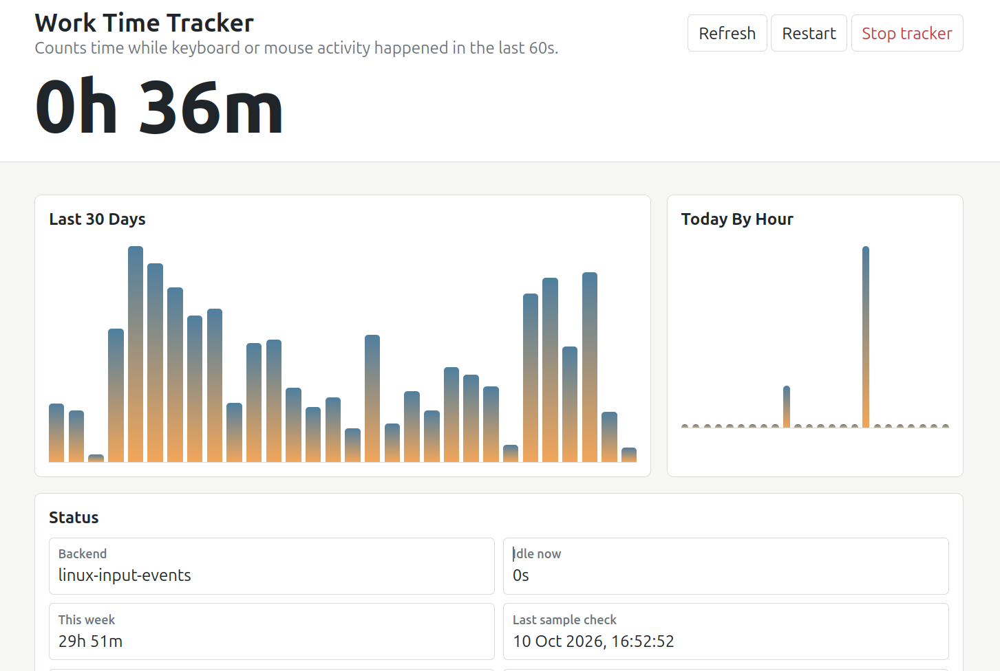

# Work Time Tracker

Local, dependency-free activity tracker for Linux desktops.

It counts time as active when the system idle timer says keyboard or mouse
activity happened within the last 60 seconds. It stores daily and hourly totals
in SQLite, not keystrokes, mouse positions, window titles, or screenshots.

Hourly charts start from the time this version is running. Older records only
have daily totals because earlier versions did not store hourly buckets.

## Example



## Installation

Requires a Linux desktop, Python 3.10 or newer, Git, and a browser. No Python
packages need to be installed. An available idle backend is required to count
activity; direct input permissions are optional (see the advanced guide below).

Clone into a permanent location without spaces in its path, then install the
desktop launcher and login autostart as your normal user (no `sudo`):

```bash
git clone https://github.com/avnikonenko/work-time-tracker.git "$HOME/work-time-tracker"
cd "$HOME/work-time-tracker"
python3 activity_tracker.py --install
python3 activity_tracker.py --open
```

The tracker starts automatically when you log into your desktop. Open **Work Time Tracker** from your application menu at any time.
Keep the checkout at this location: the launchers reference its absolute path.
If you move it, run `--install` again from the new location.

### Optional Terminal Command

For Bash, add this function to `~/.bashrc` (adjust the path if you cloned elsewhere):

```bash
check-work-time() {
    case "${1:-}" in
        ""|--show) python3 "$HOME/work-time-tracker/activity_tracker.py" --open ;;
        *) python3 "$HOME/work-time-tracker/activity_tracker.py" "$@" ;;
    esac
}
```

Load it into the current terminal, then use:

```bash
source ~/.bashrc
check-work-time
check-work-time --show
check-work-time --status
check-work-time --stop
```

Stopping ends the current session; autostart remains enabled for the next login.
To disable autostart and remove the launcher, run `python3 activity_tracker.py
--uninstall` from the checkout. This preserves saved statistics; remove the Bash
function separately if you added it.

## Commands

Run these from the repository directory:

```bash
python3 activity_tracker.py --serve
python3 activity_tracker.py --start
python3 activity_tracker.py --open
python3 activity_tracker.py --status
python3 activity_tracker.py --stop
python3 activity_tracker.py --install
python3 activity_tracker.py --uninstall
```

The dashboard is served at:

```text
http://127.0.0.1:8765/
```

## Files

- Data: `~/.local/share/activity-time-tracker/activity.sqlite3`
- Log: `~/.local/state/activity-time-tracker/tracker.log`
- Autostart file: `~/.config/autostart/activity-time-tracker.desktop`
- App launcher: `~/.local/share/applications/activity-time-tracker.desktop`

## Idle Backends

The tracker tries these input-idle backends, in order:

1. Direct Linux input events through stable `/dev/input/by-path` and `/dev/input/by-id` device links
2. `xprintidle`
3. X11 `libXss` through Python `ctypes`
4. GNOME Mutter D-Bus through `gdbus`
5. KDE screensaver D-Bus through `qdbus`

If none are available, the daemon logs a clear error and does not count time.

## Advanced Option

Direct Linux input tracking is optional. Without readable input devices, the
tracker falls back to desktop idle timers, which can be less accurate on some
systems. See [Linux input events setup](docs/linux-input-events.md) for setup,
permission risks, and alternatives.
